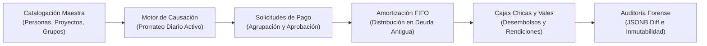

<div align="center">

# Vigencia Payment Control System

### *Sistema Integral y Auditable de Control de Pagos, Causaciones y Asignaciones Multidisciplinarias*

[](https://www.typescriptlang.org/)
[](https://adonisjs.com/)
[](https://svelte.dev/)
[](https://tailwindcss.com/)
[](https://neon.tech/)
[](https://pnpm.io/)
[](https://www.docker.com/)

<p align="center">
  <b>Universidad de Carabobo</b> • Facultad de Ciencias y Tecnología (FACYT) • Escuela de Computación<br>
  <i>Cátedra de Sistemas de Información — Octubre 2026</i>
</p>

---

</div>

## Visión General del Proyecto

**Vigencia Payment Control System** es una plataforma cliente-servidor de alta fidelidad, robustez financiera y auditoría continua, diseñada para sustituir los esquemas de gestión manuales en hojas de cálculo por un entorno auditable, inmutable y automatizado. 

El sistema administra asignaciones económicas en **dólares estadounidenses (USD)** para equipos de investigación multidisciplinarios (física, química, biología y afines). Responde con exactitud matemática y en tiempo real a las preguntas operativas esenciales:
- **¿Cuánto se ha causado?**
- **¿Cuánto se ha pagado?**
- **¿Cuándo y a quién?**
- **¿Con cargo a qué proyecto de investigación?**
- **¿Cuál es el saldo deudor consolidado e individual por beneficiario?**

> [!IMPORTANT]
> **Modelo Operativo:** No se trata de nómina parafiscal laboral formal con deducciones de ley. Los **beneficiarios (personal que cobra) NO poseen credenciales de acceso ni interactúan con el sistema**; sus registros son operados y controlados exclusivamente por los roles asignados.

---

## Capacidades y Objetivos Futuros del Sistema

El sistema implementará de forma progresiva un conjunto de motores financieros, de control y de reportería orientados al cumplimiento de las especificaciones funcionales:



### 1. Motor de Asignaciones y Causación Dinámica
- **Periodicidades Adaptables:** Soporte parametrizable para ciclos de pago semanales, quincenales y mensuales con fechas de corte dinámicas.
- **Prorrateo Exacto de Días Activos:** Cálculo de causaciones considerando fechas efectivas de inicio y fin del personal en cada periodo (`dias_activos / dias_totales_periodo * monto_base`).
- **Generación por Lotes:** Procesamiento masivo de causaciones con transacciones ACID para garantizar consistencia total sin registros huérfanos.

### 2. Solicitudes de Pago y Algoritmo FIFO (First-In, First-Out)
- **Agrupación y Estados de Solicitud:** Flujo de estados estricto: `CREACION` -> `ENVIO` -> `APROBACION` -> `ENTREGA` -> `CIERRE`.
- **Amortización Estricta FIFO:** Los pagos parciales o consolidados se imputan de forma obligatoria contra la deuda pendiente más antigua del beneficiario en el proyecto.
- **Inmutabilidad Financiera:** Todos los movimientos aprobados son inmutables. Las rectificaciones se gestionan exclusivamente mediante anulaciones formalmente justificadas con trazabilidad.

### 3. Gestión Integral de Cajas Chicas y Vales de Emergencia
- **Apertura y Cierre Mensual:** Control de fondos asignados por proyecto para gastos operativos o anticipos menores.
- **Vales de Caja:** Emisión de desembolsos rápidos, autorización gerencial y rendición documentada con comprobantes digitales.
- **Arrastre de Saldos:** Conciliación mensual y pase de balances hacia el siguiente periodo contable.

### 4. Segregación Estricta de Funciones (RBAC) y Seguridad
- **Políticas RBAC:** Implementación con `@adonisjs/bouncer` que restringe al rol `Administrador` de realizar desembolsos monetarios, reservando la aprobación de fondos al rol `Receptor`, y la generación técnica al rol `Generador`.
- **Autenticación Opaque Access Tokens:** Tokens de acceso de alta entropía con hashing en base de datos (@adonisjs/auth) y revocación inmediata.
- **Trazabilidad Forense (`audit_log`):** Registro automático de cambios de estado, anulaciones y transacciones en tablas estructuradas con deltas `JSONB` (datos previos vs. datos nuevos).

### 5. Generación Automatizada de Documentos y Reportes
- **Recibos Individuales de Pago:** Generación de comprobantes en PDF con desglose de periodos, días causados, monto abonado y saldo remanente.
- **Solicitudes de Pago Consolidadas:** Documentos ejecutivos listos para firma y archivo físico/digital.
- **Tableros Analíticos:** Métricas en vivo de deuda acumulada, fondos erogados y proyecciones de gasto por proyecto de investigación.

---

## Stack Tecnológico Unificado (TypeScript End-to-End)

| Capa | Tecnología / Herramienta | Propósito / Función |
| :--- | :--- | :--- |
| **Backend** |  | API RESTful modular, tipado estricto, IoC Container y Service Providers |
| **Frontend** |  | Reactividad granular con Runes (`$state`, `$derived`, `$props`), snippets y SSR/SPA |
| **Estilos & UI** |  | Sistema de diseño Glassmorphism corporativo (Dark/Light mode) con `@tailwindcss/vite` |
| **Persistencia** |  | Base de datos relacional serverless en Neon DB con triggers y constraints de integridad |
| **ORM** |  | Modelado relacional, transacciones ACID continuas y migraciones versionadas |
| **Validación** |  | Validación de esquemas y DTOs en tiempo de ejecución con inferencia estática |
| **Seguridad & RBAC** |  | Policies y Gates para control de acceso y separación de deberes |
| **Monorepo** |  | Gestión unificada de dependencias para `@app/backend`, `@app/frontend` y `@app/shared` |
| **Contenedores** |  | Orquestación uniforme de servicios y homologación de entornos |

---

## Sistema de Diseño: Glassmorphism Corporativo

La interfaz de usuario implementa un sistema visual moderno diseñado para jornadas operativas extensas:

- **Superficies Translúcidas:** Tarjetas y modales con `backdrop-filter: blur(12px)`, esquinas pronunciadas (`rounded-2xl`) y bordes luminosos hiperfinos (`border-white/10` o `border-black/5`).
- **Modo Claro (Light Mode):** Lienzo base en crema cálido editorial (`#FDFBF7` / `#FAF7EE`) con tarjetas en vidrio blanco translúcido (`rgba(255, 255, 255, 0.75)`), minimizando la fatiga visual.
- **Modo Oscuro (Dark Mode):** Fondo en gris plomo profundo (`#0F172A` / `#181E29`) con paneles en vidrio ahumado (`rgba(30, 41, 59, 0.65)`) y acentos en verde esmeralda luminiscente y ámbar dorado.

---

## Arquitectura del Monorepo

```plaintext
Vigencia_Payment_Control_System/
├── backend/                  # API RESTful con AdonisJS v6
│   ├── app/                  # Controladores, Modelos, Validadores y Políticas RBAC
│   ├── config/               # Configuraciones (DB, Auth, Cors, Bouncer)
│   ├── database/             # Migraciones DDL, Seeders y Schemas
│   ├── start/                # Kernel HTTP, Rutas y Validación de Variables (.env)
│   └── package.json          # @app/backend
├── frontend/                 # Aplicación Web con Svelte 5 + Vite
│   ├── src/                  # Rutas SvelteKit, Runes y Componentes UI
│   ├── static/               # Assets estáticos y recursos públicos
│   └── package.json          # @app/frontend
├── packages/
│   └── shared/               # Contratos y tipos compartidos
│       ├── src/index.ts      # Enums de Dominio (RolUsuario, EstadoSolicitud)
│       └── package.json      # @app/shared
├── docs/                     # Documentación técnica preliminar y arquitectura
├── pnpm-workspace.yaml       # Definición de paquetes del workspace
├── package.json              # Orquestador raíz de scripts con concurrently
└── README.md                 # Documentación principal del repositorio
```

---

## Equipo de Desarrollo y Matriz RACI

| Integrante | Rol Principal | Áreas de Enfoque |
| :--- | :--- | :--- |
| **Sebastián Piñango** | *Project Manager & Lead Frontend* | Arquitectura de software, DevOps/CI-CD, UI/UX en Svelte 5 con Glassmorphism |
| **Edgar Gutiérrez** | *Lead Backend & DBA* | Arquitectura base AdonisJS v6, diseño relacional PostgreSQL, triggers y Lucid ORM |
| **Anthony Quero** | *Fullstack & Lead QA* | Desarrollo transversal de características, diseño de suites de pruebas y criterios de aceptación |
| **Juan Sanabria** | *Backend & AppSec Specialist* | Arquitectura de seguridad, autenticación por tokens, RBAC con Bouncer y auditoría forense |
| **Ulises Rondón** | *Backend & API Integration* | Endpoints RESTful, contratos DTO con VineJS, middlewares y serialización de respuestas |

---

## Comandos de Desarrollo

```bash
# 1. Instalar todas las dependencias del monorepo
pnpm install

# 2. Levantar backend (3333) y frontend (5173) en paralelo
pnpm run dev

# 3. Comandos individuales por entorno
pnpm run dev:backend      # Solo backend (AdonisJS con Hot Reload)
pnpm run dev:frontend     # Solo frontend (Vite Dev Server)

# 4. Compilación recursiva de producción
pnpm run build
```

---

<div align="center">
  <small>Desarrollado con dedicación por el equipo de Sistemas de Información • FACYT • Universidad de Carabobo</small>
</div>
